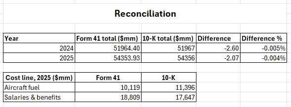
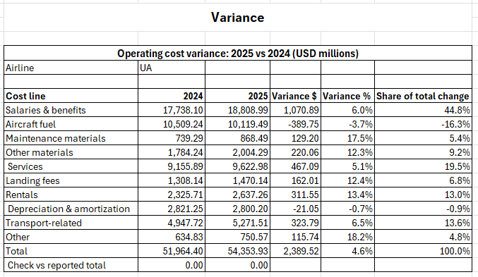
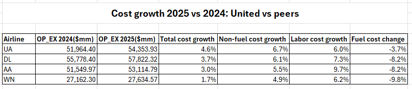
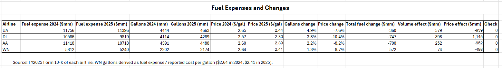
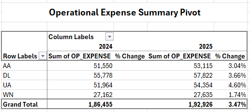
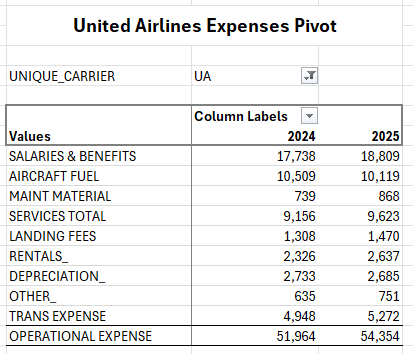

# Airline Operating Cost Variance Analysis: United Airlines vs. Peers

**Question:** Why did United Airlines' operating costs rise in 2025, and how does that compare with Delta, American and Southwest?

**Tools:** Advanced Excel (SUMIFS, pivot tables, Paste Special, data validation, structured tables)

## Key findings
1. **United's costs grew fastest:** +$2.39B (+4.6%) vs. +3.7% Delta, +3.0% American, +1.7% Southwest.
2. **Labor was not the cause:** United's labor cost growth (6.0%) was the lowest of the four. Non-fuel costs grew fastest (6.7%), driven by rentals, landing fees and maintenance as United expanded its fleet.
3. **Fuel savings were the smallest:** lower prices saved United $939M, but it burned 4.9% more fuel, adding $579M. Its fuel bill fell only 3.7% vs. 8–10% at peers.

## Data
- **U.S. DOT Form 41, Schedule P-6** (operating expenses by objective), 2024–2025, from BTS TranStats: 771 records for all U.S. carriers, filtered to 112 rows for the four airlines, converted from thousands to millions of USD.
- **FY2025 Form 10-K** of each airline, for fuel gallons and the 10-K tie-out.

## Method
1. **Load:** combined the 2024 and 2025 Form 41 files into one Excel table (771 rows).
2. **Clean:** filtered to UA, DL, AA and WN (112 rows), kept 12 cost columns, and converted thousands to millions with Paste Special → Divide.
3. **Summarise with pivot tables:**
   - **Summary pivot:** total operating expense by airline (rows) and year (columns), plus a second value field using *Show Values As → % Difference From (previous year)*, which showed United's costs grew fastest (+4.6%).
   - **UA_Lines pivot:** United's 10 cost lines by year, using a report filter for the airline and Σ Values moved to rows. This showed salaries up $1,071M while fuel fell $390M.
4. **Reconcile:** added a row-level check column and tied United's totals to its 10-K.
5. **Variance analysis:** SUMIFS-driven table with a data-validation airline dropdown, showing $ change, % change and each line's share of the total increase.
6. **Peer and fuel analysis:** compared cost growth across the four airlines and split fuel variance into price and volume effects.

## Workbook structure
| Sheet | Purpose |
|---|---|
| Raw | Original Form 41 data |
| Clean | 4 airlines, 12 cost columns, USD millions, with a row-level check column |
| Summary / UA_Lines | Pivot tables: total cost by airline, United by cost line |
| Recon | Reconciliation checks |
| Variance | 2025 vs. 2024 by cost line, with an airline dropdown |
| Peers | Cost growth comparison across the four airlines |
| Fuel | Fuel price vs. volume variance split |

## Reconciliation
- Every row's 9 cost groups sum to reported total operating expense (max difference: 0.00).
- United's Form 41 total matches its 10-K within 0.005% (2025: $54,353.9M vs. $54,356M).
- Line-level classification differs between Form 41 and the 10-K (e.g. 2025 fuel: $10,119M vs. $11,396M), so peer comparisons use Form 41 only and fuel price/volume uses 10-K data only.

## Screenshots

